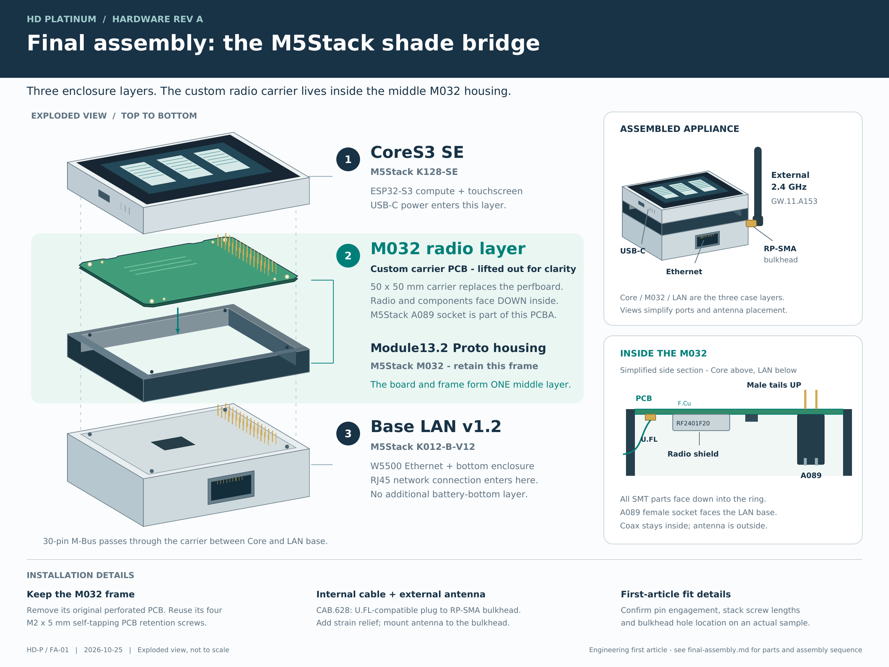

<!--
SPDX-FileCopyrightText: 2026 Christopher Spitler
SPDX-License-Identifier: CC-BY-SA-4.0 OR AGPL-3.0-or-later
-->

# Final appliance assembly drawing

Open the [printable vector PDF](final-assembly.pdf), [editable SVG](final-assembly.svg)
or [PNG preview](../reports/final-assembly.png). Drawing **HD-P / FA-01**, issued
2026-10-25, depicts carrier revision A.

The finished enclosure has **three layers**, in this top-to-bottom order:

| Layer | Part | What it does |
| --- | --- | --- |
| 1: top | M5Stack **CoreS3 SE, K128-SE** | ESP32-S3 controller, touchscreen and USB-C power input |
| 2: middle | M5Stack **Module13.2 Proto, M032**, with the project's carrier replacing its original perfboard | Encloses the radio, power circuit, coax connection and pass-through M-Bus socket |
| 3: bottom | M5Stack **Base LAN v1.2, K012-B-V12** | W5500 Ethernet, RJ45 connection and bottom enclosure |

The drawing separates the carrier from the M032 ring to show assembly. These
are **one finished middle layer**, not two separate enclosure modules. The
CoreS3 SE SKU is supplied without a battery bottom; this assembly uses the LAN
base at the bottom. The LAN base's optional DIN mounting accessories are not
required for the illustrated tabletop configuration.

## What goes inside M032

- **Custom carrier PCBA:** 50 x 50 mm, located at the upper board seat. Remove
  the M032 perfboard rather than placing the carrier on top of it. Retain the
  frame and four original M2 x 5 mm self-tapping PCB retention screws.
- **M5Stack A089:** the 30-pin pass-through socket installed as J1 on the
  carrier, not an additional enclosure layer. Its female housing faces down
  inside the ring; its male tails pass through the board toward the Core.
- **NiceRF RF2401F20:** U1 on the bottom/component face. The radio shield,
  other SMT parts and **Hirose U.FL-R-SMT-1(10)** connector J2 all face down
  toward the LAN base.
- **Taoglas CAB.628:** the internal 95 mm coax pigtail. Its I-PEX MHF I plug
  mates with J2 and its RP-SMA female bulkhead mounts at the enclosure wall.
  Add strain relief so antenna movement cannot load J2.

The **Taoglas GW.11.A153** antenna screws onto the bulkhead outside the
enclosure. The assembled inset illustrates an antenna attached directly at
the wall; the coax remains inside. The depicted wall location is illustrative
and must be finalized on the first article.

## Assembly sequence

1. With power disconnected, remove the M032 perfboard and install the
   inspected carrier in its place, with components and the female socket
   facing into the ring.
2. Fit the approved bulkhead and strain relief; connect and route CAB.628
   clear of contacts, screw paths and enclosure seams.
3. Align the Core, completed M032 radio layer and LAN base. Verify M-Bus
   pin-1 orientation, pin engagement and natural seating before tightening
   the fit-selected stack screws. The PCB retention screws are separate
   from the whole-stack fasteners.
4. Attach the external antenna and an RJ45 patch cable. Use the selected
   **Raspberry Pi SC0218 5.1 V / 3 A USB-C supply** at the Core. Leave the
   LAN base's separate DC input unconnected; firmware must enable M-Bus 5 V.
5. Complete the [acceptance procedure](acceptance-test.md). Record the
   accepted bulkhead location, screw lengths and cable routing for repeats.

The [full assembly instructions](assembly.md), [system BOM](system-bom.csv)
and [bottom PCBA drawing](assembly-bottom.pdf) control the accompanying
details. This illustration is not to scale and does not specify drill
locations, case modifications, exact connector positions or screw lengths.
Physical enclosure fit and header engagement still require a sample check.

## Drawing sources and reproduction

The drawing is an original schematic illustration, not a vendor render or
an assembled STEP model. Its board perimeter is read from
[module132-mechanical.json](../design/module132-mechanical.json). Internal
orientation follows the project's [mechanical evidence](../design/mechanical-evidence.md).
The following manufacturer sources were checked on 2026-10-25:

- [CoreS3 SE documentation](https://docs.m5stack.com/en/core/CoreS3-SE) and
  [K128-SE without battery bottom](https://shop.m5stack.com/products/m5stack-cores3-se-iot-controller-w-o-battery-bottom).
- [M032 Module13.2 Proto](https://docs.m5stack.com/en/module/Module13.2_Proto).
- [Base LAN v1.2](https://docs.m5stack.com/en/base/Base_LAN_v1.2).
- [A089 Bus Socket DIP 13.2](https://docs.m5stack.com/en/accessory/Bus_Socket_DIP_13.2).
- [CAB.628 pigtail drawing](https://www.taoglas.com/datasheets/CAB.628.pdf) and
  [GW.11.A153 antenna drawing](https://cdn.taoglas.com/datasheets/GW.11.A153.pdf),
  as recorded in the existing [mechanical sources](../references/mechanical-sources.md).

Regenerate the PDF, SVG and preview with
[draw_final_assembly.py](../tools/draw_final_assembly.py), using the existing
hardware container. The [tool instructions](../tools/README.md) include the
standalone command. The output SVG and rendered drawing follow the hardware
documentation license recorded in [hardware/LICENSE.md](../LICENSE.md).
